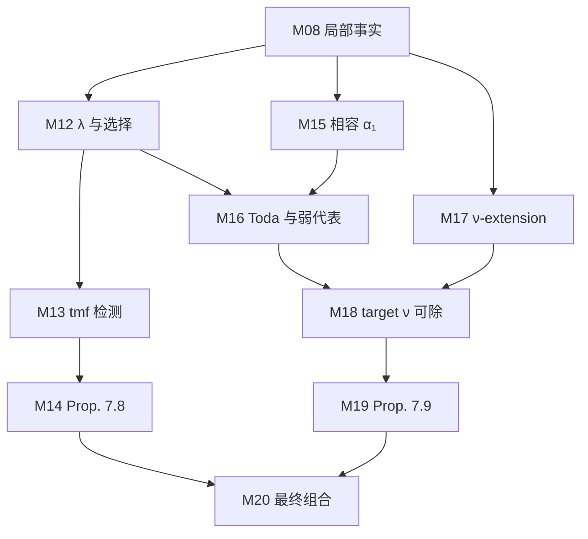

# Milestone 接口与并行形式化

本轮以 `develop` 的 `1151a405a004d74513f0b788da99a275a8640adf` 为审查基线，
已纳入本次工作期间合入的 Lean module 迁移、正文模块拆分与工具证明进展。
先由数学家核对命题、定义和依赖，记录冻结的接口，再让各条线独立实现证明。
上游接口已经冻结而证明仍未完成时，下游可以依照该接口开发；完成度仍按真实证明依赖验收。

本方案沿用 [PROJECT_BOUNDARY.md](../PROJECT_BOUNDARY.md) 与
[STAGE0_INTERFACES.md](STAGE0_INTERFACES.md) 的责任边界。
当前终点是标准 `h₆²` 的非零永久存活；保留外部文献和计算作为显式数学输入。
冻结接口不会改变这些输入的地位，也不会证明其生产者已经完成。

## 入口与单一事实来源

| 内容 | 位置与职责 |
| --- | --- |
| 数学定义、完整类型与证明 | `KIP126/`；Lean 声明是接口实际内容 |
| 数学计划与细粒度依赖 | `blueprint/src/`；保持现有稳定标签 |
| 外部来源、定位与输入摘要 | [external-inputs.json](external-inputs.json)；继续作为唯一来源清单 |
| 本轮接口登记与调度状态 | [milestones.json](milestones.json)；20 个大粒度交付，引用前述内容 |
| 首轮数学审查问题 | [MILESTONE_REVIEW.md](MILESTONE_REVIEW.md)；M08、M09–11、M16/M19、M20 的具体裁定 |
| 机器校验与候选审查快照 | `python3 scripts/milestones.py` |
| 原 Blueprint frontier 与新增冻结接口队列 | `python3 scripts/blueprint_frontier.py --output-dir metrics/frontier` |

登记表的依赖是待审核的任务切分，不能当作 Lean 自动提取的证明依赖图。
`blueprint_labels` 将 milestone 连接到现有节点，不要求每个声明都有一一对应的标签；
缺失直接绑定处已列为审查问题。外部输入只用 JSON Pointer 引用规范清单，来源定位和哈希不在此复制。

初始登记的 20 项均为 `statement_status: draft`、`proof_status: open`；
`owner`、`review`、`proof_evidence` 均为空。
接受这套工作安排只授权建立登记与审查流程，尚未构成任何具体数学接口的审核结论。

## 20 个 milestone

精确的公开 Lean 名称、文件、Blueprint 标签、来源引用、依赖和验收项以登记表为准。
下表提供认领入口；同一 milestone 可以拆成几个实现 PR，而保持一个稳定输出接口。

| ID | 交付 | 首先要冻结的内容 | 主要协作线 |
| --- | --- | --- | --- |
| M01 | 标准目标与经典基础 | 标准球谱、Milnor `h₆²`、非零存活谓词及固定实现的构造义务 | 基础 |
| M02 | Synthetic 背景及适用性 | 固定 route 背景、球谱适用性、分离性及其输入 | 基础 |
| M03 | ESS 与代表元接口 | 微分与代表元关系、无 crossing 下的目标比较、有限页延拓 | 工具 |
| M04 | 文献交付 | 同一 `LiteratureBindings` 上的结果包与 Def 模型的绑定 | 文献 |
| M05 | 同一 E₂ 坐标比较 | 同一 presentation 上的基、乘法、平方及标准类识别 | 计算 |
| M06 | 计算解释与认证 | 固定输入的语义、staircase、局部证书到数学结论的桥梁 | 计算 |
| M07 | 文献到正文的内部适配 | Moss、移位自然性、Toda 和 ν-source 的内部应用 | 文献 |
| M08 | §7 局部球谱与 Cν 事实 | 将 `sphere_facts` 拆为可审查局部结论，裁定两处缺口 | 计算 |
| M09 | 广义 Leibniz | 页数、次数、永久性、延拓与两组 no-crossing 假设 | 工具 |
| M10 | 广义 Mahowald | 真正三角、归一化、May 输入、无 crossing 与模边界结论 | 工具 |
| M11 | 有限页延拓与 stretching | 有限范围、后续 cycle 条件、不可提升 crossing 的排除 | 工具 |
| M12 | λ、realization 与选择无关性 | 不同次数中的单射性、归一化与实际 choice-independence 生产者 | Prop. 7.8 |
| M13 | tmf 高过滤检测 | 有限页到永久存活、实际 detector、过滤穷尽及分离性 | Prop. 7.8 |
| M14 | Proposition 7.8 | 永久存活与唯一候选 `d₁₂` 的排他分解，及 C3/C4/C5 判据 | Prop. 7.8 |
| M15 | 相容 α₁ | 同一个选择在 Q11 与 Q9 的投影及所需同伦等式 | Prop. 7.9 |
| M16 | Toda 与弱代表构造 | 真正 Toda 与检测见证、非零条件，以及应公开的窄引理 | Prop. 7.9 |
| M17 | Q5→Q9 ν-extension | 同一个延拓的提升、投影和代表元兼容性 | Prop. 7.9 |
| M18 | target ν 可除 | 真正球谱中的 ν 可除结论及与截断见证的连接 | Prop. 7.9 |
| M19 | Cν 矛盾与 Proposition 7.9 | 同一 Cν target 的 incoming differential 与 C3 排除 C5 | Prop. 7.9 |
| M20 | 最终条件组合与验收 | 同一显式 `Challenge2` 输入贯穿组合，及版本化的最终合同 | 集成 |

M06 暂按现有计算重放路线保守地依赖 M09、M10、M11。
若审核选定不使用其中某工具的直接证明，可在同一审查 PR 中收窄任务依赖；
不能只为让队列提前显示 ready 而删除依赖。
M16 采用弱代表构造链；`MainToda` 和 `AnyY` 中由最终矛盾导出的推论属于下游。
M20 中拟议的显式输入总定理尚不是现有公开声明，登记表没有把它冒充为已存在的接口。

## 两个独立状态

| 字段 | 状态 | 含义 |
| --- | --- | --- |
| `statement_status` | `draft` | 命题与依赖尚待数学审查 |
| | `frozen` | 已记录具体审查对象、人员、结论与来源快照 |
| | `reopened` | 原冻结边界需要重新裁定 |
| `proof_status` | `open` | 尚未记录完成证据，允许已有部分证明 |
| | `conditional` | 已有依赖上游义务的证明进展，仍需说明保留条件 |
| | `closed` | 有明确的证明验收记录；报告只称 `closed_by_record` |

调度器独立计算当前接口是否仍匹配审查快照，以及所有任务依赖是否已冻结且仍有效。
自身和依赖接口都有效、没有未解决的审查阻碍时，可进入“基于冻结接口可开工”队列。
上游 `proof_status: open` 不妨碍这个队列；上游接口过期会沿依赖传播阻塞。
已登记 `closed` 的任务不再进入待实现队列；该记录也不能遮盖接口过期。

脚本校验审查记录的结构，不认证审查者身份，不替数学家批准命题，
也不根据 `\leanok`、无局部 `sorry` 或编译成功推断证明完成。
最终数学验收仍要读取 Lean 的实际定义、完整 elaborated type 与公理依赖。

## 一次接口审查应交付什么

每项由一名数学责任人和一名熟悉 Lean 类型与仓库边界的复核人协作。
开始阶段可以集中审核共享基础，之后按主题拆开；实际人员由团队认领。
审查记录至少回答以下问题。

1. **语义与完整类型。** 写出预期数学陈述，核对 universe、隐式参数、类型类、页数、次数、
   synthetic weight、范围和结论强度。检查使用的定义确实表达目标对象。
2. **输入的身份。** 确认 presentation、realization、文献与计算结果来自同一个输入。
   M05–M08 不能将两个独立存在量词中的 presentation 当成相等，也不能把特定 presentation 的结果推广为任意 presentation。
3. **数学依赖。** 明确一般理论、保留的外部假设与本项目内部证明的区别。
   回查 Blueprint 和来源清单，检查没有直接或间接使用下游结论。
4. **下游可用性。** 至少选一个真实消费者，说明只靠冻结输出如何推进它的证明。
   避免输出过弱无法使用，或输出过强而承担正文根本不需要的困难。
5. **证明责任与范围。** 写清生产者要证明的构造、比较、存在性、非零性与唯一性；
   确定 `write_scope` 和公共文件协调人。开放问题与候选替代方案保留为 blocker。
6. **可复核记录。** 保存审查 commit、PR 或仓库记录、实际审查者与快照，
   清空已解决的 `review_blockers` 后将 `statement_status` 改为 `frozen`。

`review_blockers` 描述阻碍冻结的待决问题；一般性的待证明义务放入 `acceptance` 或 `notes`。
已经确定为正确构造任务的一个 `sorry` 可以保留到证明阶段，
而“当前输入究竟能否推出这一命题”的争议必须先裁定。

## 快照与状态更新

先运行结构检查和现有报告：

```sh
python3 scripts/milestones.py --check
python3 scripts/blueprint_frontier.py --output-dir metrics/frontier
```

准备审查记录时生成候选快照：

```sh
python3 scripts/milestones.py --snapshot M01
```

该命令只输出候选值，不写入批准或修改状态。
`review` 保存 `commit`、`record`、`reviewers`、`contract_hash`、`source_hashes` 和 `dependency_reviews`。
`contract_hash` 绑定选定声明、目标、定义范围、来源引用、任务依赖、Blueprint 标签和验收项；
在同一文件中换一个目标声明也会触发复核。认领人、证明进度等行政字段不计入这个摘要。
其中源文件集合是公开声明文件、`definition_files`，以及固定的
`lean-toolchain`、`lake-manifest.json`、`PROJECT_BOUNDARY.md`、`docs/external-inputs.json`。
上游指纹是其审查对象的规范化 JSON 摘要，由快照命令生成；尚未审核的依赖会明确列出。
快照的候选 commit 是当前 Git HEAD，文件摘要描述当前工作树；有未提交改动时两者未必相符。
正式记录应指向已提交且实际审核的内容，不应直接把一份未提交的候选快照当作审查版本。
`proof_evidence` 记录对应 commit、可追溯的验收记录、执行的检查及报告的公理；
`closed` 必须提供它，记录本身仍需人工核实。

**首版采用整文件 SHA-256 作为保守的变更提示。** 它不是 Lean 语义指纹：
相同摘要不证明声明的完整语义正确，证明体或同文件其他声明的改动也会触发过期。
`definition_files` 的覆盖范围需要审查者补全；工具不会自动寻找所有传递定义。
实现 PR 若只改变证明，复核人可对照完整类型与已冻结定义，确认接口保持一致后更新快照和记录；
若改变输入、定义、范围或结论，则重开审查，并通知所有任务下游。
不要用自动重算摘要代替复核。

源快照、上游审查指纹或上游有效性变化时，报告将任务列为需要复核或被接口阻塞。
改动声明位置、定义范围或任务依赖时，可以保留原审查快照作为历史记录；
它与当前合同不同会使任务过期，不会强迫实现 PR 先取得新的数学批准才通过普通 CI。
普通开发 CI 仍可通过；结构损坏、无效路径、无效 Blueprint 标签、坏来源引用和依赖环会使检查失败。
原 Blueprint frontier 保持原来的含义；新队列位于报告的独立 `milestone_scheduling` 字段。
这让“按 Blueprint 完成标记找下一项”和“按冻结接口分配证明工作”可以同时查看。

## 如何并行

每个 milestone 只设一位实现 owner；一个人可认领多项，但不要让多个工作区同时改同一个证明体。
数学审查可以并行准备，正式快照按依赖关系衔接。
完成一层接口审核后即可开展下游审查，无需等待该层全部证明完成。

| 协作线 | 责任 | 建议拆分与交接 |
| --- | --- | --- |
| 基础 | M01–M02 | 先冻结标准目标、背景与适用性；构造与比较证明分别安排实现 |
| 工具 | M03、M09–M11 | M03 输出固定后，Leibniz、Mahowald、有限 stretching 三项分别开工 |
| 文献 | M04、M07 | 核对同一 bindings 与来源，再逐项证明 Main 内部适配 |
| 计算 | M05、M06、M08 | 分开坐标比较、记录语义/认证、§7 局部事实；共同维护同一 presentation |
| Prop. 7.8 | M12–M14 | 将 λ/选择、tmf 检测拆开；在输出固定后由 M14 组合 |
| Prop. 7.9 | M15–M19 | 相容 α₁/Toda 弱代表链与 ν-extension 分支推进，再交给 M18–M19 |

下图展示两条正文线的主要交接；共享基础、文献和工具等全部直接依赖以登记表为准。



集成人维护 M20 和公共文件的合并顺序；这是横跨六条线的责任，不要求另配一整组。
人数少时优先保留数学审核、工具/基础、计算/正文三个职责，再按 milestone 拆任务。

工作区从同一个包含冻结接口的 commit 分出，例如：

```sh
git worktree add -b work/m09-leibniz ../Kervaire126-m09 <frozen-commit>
git worktree add -b work/m10-mahowald ../Kervaire126-m10 <frozen-commit>
```

任务说明附上 milestone ID、冻结 commit/审查记录、明确的声明与 `write_scope`、输入依赖和验收命令。
实现者发现接口不足时，先提交最小反例、缺失假设或所需窄引理供协调；
接口修订进入独立 PR，并同步 Lean、Blueprint 与登记表。
`write_scope` 是认领与冲突提示，脚本不据此限制文件写入或代替 Git 权限。

当前代码已经把较大的正文文件拆成实际子模块，可直接据此分工：
`Computation/Route/` 分出命名存活、球谱微分、incoming、Cν/过滤等模块，
`Route/AlphaOne/` 分出有限窗口、穷尽、过滤与存在性，
`Route/Selected/` 分出 `ThetaData`、`ClassicalData`、`ChoiceInvariance`、`DetectionData` 与 `Assembly`。
实现分支应优先认领这些独立模块；`StageInput.lean`、`Lambda.lean` 及公共组装入口由协调人串行合并。
拆文件后仍需审核跨模块的窄输出，不能把 `import all` 或私有 helper 可访问当成接口已经审核。
后续抽取保持公开接口稳定，并产生实际模块内容。

实现 PR 说明“输入接口是什么、证明了什么、剩余条件是什么”，附实际构建与必要回归结果。
使用尚未完成的上游声明后，可以登记为 conditional 并列出条件；
只有证明依赖和保留假设都经过验收，才登记 closed 的证据。
不要把所有 milestone 的局部记录相加当作 M20 的完整公理审计。

## 首轮工作顺序

1. **先准备共同对象。** M01、M02、M04、M05 的审查可同时读源与列问题，
   冻结时按依赖确认标准对象、背景、同一 bindings 与 presentation。
   同时准备 M03 和 M09–11 的具体假设清单。
2. **立即裁定 M08。** 审查包给出 staircase row 3005 到当前 `Inputs` 的桥梁、
   `NeverHit` 的 `d₉` 缺口，以及排除截至 `d₆` 的累计边界 `B₆` 的候选收窄。
   先选择实际证明路线，再冻结计算线和正文线共同依赖的输出。
3. **冻结正文的分支输出。** Prop. 7.8 审查 M12/M13，Prop. 7.9 审查 M15–M17，
   避免将已由最终矛盾推出的 Toda 推论倒用为 M16 的独立输入。
4. **尽早审查 M20 合同。** 明确外部输入如何显式保留、同一 witness 如何贯穿，
   以及现有无参数 Challenge/Solution 对如何在后续经过审核的版本中更新。
   本轮只登记这项工作，不改变当前最终声明和项目边界。

首轮没有“已由数学家冻结”的任务，因此初始冻结接口开工队列为空，这是登记的准确状态。
可立即开展上述审查准备、现有证明探索和任务认领；通过一批具体接口审核后，队列会显示可按稳定接口并行的任务。

## 方法来源

[FrenzyMath 的 Poincaré formalization 报告](https://frenzymath.com/blog/poincare-formalization/#accelerating-the-formalization)
提供了先审核 milestone、固定依赖和接口、再由独立工作区推进的工作方式。
本仓库将它落在现有 Lean、Blueprint、来源清单及简洁 CI 上。
登记器只负责一致性和调度信息；数学判断与证明验收由具体审查记录、Lean 构建和公理审计承担。
